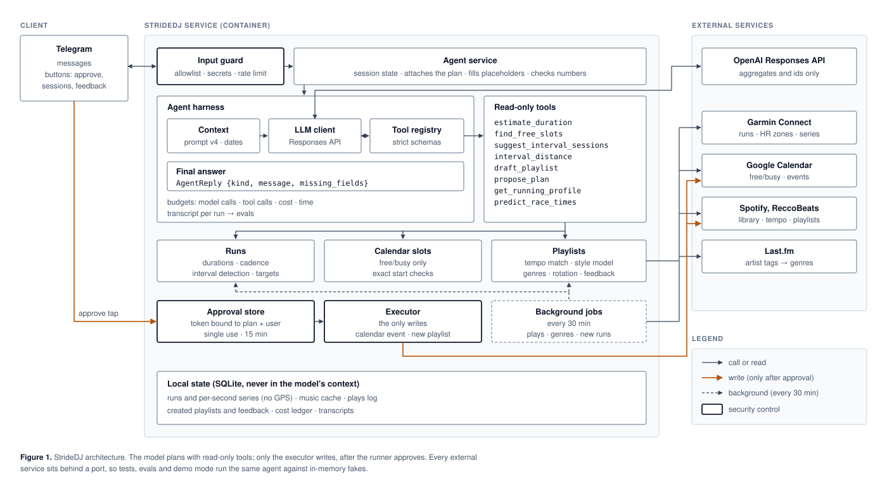

<div align="center">

# StrideDJ

**Text your running agent *"10k Z2 tonight"*. It sizes the run from your own Garmin history, finds a free slot in your calendar, builds a playlist matched to your cadence, and books nothing until you tap Approve.**

[](https://github.com/szekerbalazs/stridedj/actions/workflows/ci.yml)


</div>



## What it does
```
you        10k Z2 tonight
stridedj   Your 10 km Z2 run is proposed for 18:30 tonight, about 57 minutes, with a cadence-matched playlist.

           🏃 10 km Z2 easy run
           📅 Sat 17 Oct, 18:30–19:45
           ⏱ ~57 min expected (80%: 58 min)
              Based on 16 z2 runs of 7.5–12.5 km in the last 90 days, scaled to 10 km.
           👟 cadence target 169 spm (8 recent runs)
           🎵 16 tracks · 59 min · ±1.2 BPM
                                                        [ ✅ Approve ]  [ ✖ Cancel ]
```
On **Approve**, it creates the calendar event and a private Spotify playlist, exactly once.

**How it decides each part:**
- **Duration** comes from *your* comparable runs. If you haven't run that distance recently, it extrapolates with a personal log-log model (the classic Riegel law, fitted to you).
- **The calendar slot** is the 80th percentile plus a buffer, rounded up to 15 minutes: a newsvendor choice, because running over is worse than idle time.
- **Cadence target:** the median of your last runs of that type. It follows your fitness as it changes.
- **Playlist:** a *new* playlist in the style of your running playlist, with every track's tempo folded (½×, 1×, 2×) to your cadence.
- **Heart-rate zones** are read from Garmin Connect, so "Z2" means what it means on your watch.
- **Follow-ups and questions:** *"make it tomorrow morning instead"*, *"calmer music"*, *"how are my Z2 runs going?"*, *"what could I run a half marathon in?"*

## How it works
StrideDJ is a **tool-calling agent** inside a **hand-built harness**, with no agent framework. Every safety-relevant decision is a line of code you can point to.

1. **Guard.** Your Telegram message passes deterministic checks before any model sees it: allowlisted user, private chat, secret detector, length and rate limits.
2. **Context.** A versioned system prompt, the current date/time in your timezone, and a compact history (earlier messages and answers, no stale tool output).
3. **Loop.** The OpenAI Responses API (stateless, `store=false`) calls six **read-only** tools with strict JSON schemas until it returns a final answer, a strict `AgentReply` JSON object. The harness enforces budgets: steps, tool calls, $, wall time.
4. **Verification.** The final answer is validated, then *checked against state*: a "proposal" must reference a plan the tools really created.
5. **Approval.** The proposal card is rendered by code. Its token is bound to the plan's content hash and to you, single use, valid for 15 minutes.
6. **Execution.** Only the executor writes: one calendar event (idempotent id) and one private playlist, from fixed templates.
7. **Transcript.** Every run is recorded (model calls, tool calls, tokens, cost, latency). The evals grade these transcripts and outcomes.

### What the model can and can't see or do
| The model sees | The model never sees | The model can't |
|---|---|---|
| your message, aggregates (durations, cadence, slot times, playlist stats), ids | GPS, raw HR/pace series, activity names, song titles, calendar event titles, secrets | write anything, add attendees, send messages, edit your playlists |

Untrusted text (song titles, calendar invites) never enters the model's context, and the model has no write channel. Prompt injection is mitigated **by architecture, not by asking the model nicely**: the "lethal trifecta" is broken. Details in [docs/INJECTION.md](docs/INJECTION.md).

## Quickstart (demo mode, about 5 minutes)
Demo mode runs the *same agent* on synthetic runs, a fake calendar and a fake music library. You only need an OpenAI API key.
```bash
git clone https://github.com/szekerbalazs/stridedj.git && cd stridedj
make setup                 # uv venv (Python 3.12) + dependencies + .env from the template
#  → put your OPENAI_API_KEY into .env   (docs/SETUP.md §1)
make demo                  # chat in the terminal: try "10k Z2 tonight"
```
Requirements: macOS or Linux and [uv](https://docs.astral.sh/uv/). uv fetches Python 3.12 itself.

## Full setup (your real accounts)
Follow **[docs/SETUP.md](docs/SETUP.md)**: click-by-click, about 45 minutes, with `make doctor` confirming each step.

| Service | What you create | Notes |
|---|---|---|
| OpenAI | API key + a few $ of credit | ChatGPT subscriptions don't include API usage |
| Telegram | a bot via @BotFather + your numeric user id | long polling: no server or public URL needed |
| Spotify | a developer app (redirect `http://127.0.0.1:8888/callback`) | Premium required for dev-mode apps; your running playlist must be yours |
| Google Calendar | a Desktop OAuth client | free/busy + insert scopes; testing-mode logins last 7 days |
| Garmin Connect | your login (MFA supported) | unofficial API; HR zones are read from your account |

Then the one-time logins and a check:
```bash
uv run stridedj auth garmin && uv run stridedj auth spotify && uv run stridedj auth google
make doctor     # ✓/✗ per credential, never prints values
make smoke      # read-only live check of every integration (counts only)
make bot        # start the Telegram bot
```

### `.env` reference
All configuration and secrets live in `.env`, which is git- and docker-ignored. The template is [`.env.example`](.env.example).

| Variable | Required | Where it comes from |
|---|---|---|
| `OPENAI_API_KEY` | always | platform.openai.com → API keys |
| `OPENAI_MODEL`, `OPENAI_REASONING_EFFORT` | no | defaults `gpt-6-luna`, `low` |
| `OPENAI_ADMIN_KEY` | no | platform.openai.com → Settings → Organization → Admin keys (only for `stridedj costs`) |
| `TELEGRAM_BOT_TOKEN` | for the bot | @BotFather |
| `TELEGRAM_ALLOWED_USER_IDS` | for the bot | @userinfobot (numeric ids, comma-separated) |
| `SPOTIFY_CLIENT_ID` | live mode | Spotify dashboard → your app |
| `SPOTIFY_RUNNING_PLAYLIST_IDS` | live mode | the 22-char id from a playlist's share link |
| `SPOTIFY_REFRESH_TOKEN` | live mode | written by `stridedj auth spotify` |
| `GOOGLE_CLIENT_ID`, `GOOGLE_CLIENT_SECRET` | live mode | Google Cloud → Google Auth Platform → Clients |
| `GOOGLE_CALENDAR_ID`, `GOOGLE_BUSY_CALENDAR_IDS` | no | default `primary`; a dedicated "Runs" calendar is recommended |
| `GOOGLE_REFRESH_TOKEN` | live mode | written by `stridedj auth google` |
| `GARMIN_EMAIL`, `GARMIN_PASSWORD` | live mode | your Garmin Connect login |
| `STRIDEDJ_RUN_SOURCE` | no | `demo` (default), `garmin`, or `intervals_icu` (plan B) |
| `ATHLETE_TIMEZONE` | no | default `Europe/Zurich` |
| `GARMIN_TOKEN_DIR`, `STRIDEDJ_DATA_DIR`, `STRIDEDJ_LOG_LEVEL` | no | defaults `~/.garminconnect`, `data/`, `INFO` |

## Commands
| Command | What it does |
|---|---|
| `make demo` | terminal chat on synthetic data |
| `uv run stridedj chat --data live` | terminal chat on your real accounts |
| `make bot` | Telegram bot (`--data demo` also works) |
| `uv run stridedj auth <garmin\|spotify\|google>` | one-time logins |
| `make doctor` / `make smoke` | credential check / live read-only integration check |
| `uv run stridedj costs` | cost dashboard per API key (terminal + HTML); `/costs` in Telegram |
| `make eval-reference` / `make eval` | evals with the oracle (free) / with the real model (≈ $0.05) |
| `make check` | ruff + mypy --strict + 350+ offline tests (what CI runs) |

## Costs
Every conversation is recorded in a local **cost ledger** (`data/costs.db`): tokens, cache hits and estimated $ per run, grouped by a short **fingerprint** of the API key (never the key itself).
```bash
uv run stridedj costs        # terminal tables + an HTML dashboard in your browser (one section per API key)
```
- **With an optional OpenAI Admin key** (`OPENAI_ADMIN_KEY`, see [SETUP §1](docs/SETUP.md#1-openai-api-key)), the dashboard also shows **OpenAI's billed costs per API key** from the official Costs API: exact amounts, daily, named keys, per line item.
- **Least privilege:** the Admin key is used only by this command, never by the bot.
- **In Telegram:** `/costs` gives this month's StrideDJ spend from the ledger.

## Evals
The agent is evaluated like a product, following Anthropic's [*Demystifying evals for AI agents*](https://www.anthropic.com/engineering/demystifying-evals-for-ai-agents).
- **Tasks:** 32, in three suites:
  - **regression:** everyday requests;
  - **capability:** follow-ups, extrapolation, unit conversion, a fully booked evening;
  - **security:** poisoned invites and track titles, exfiltration and prompt extraction attempts.
- **Trials:** each runs in a fresh, isolated environment with a frozen clock.
- **Grading:** programmatic only, on **outcomes**: the plan object, and whether anything was written. No LLM judge.
- **Reference oracle:** every task has one, which must score 100 %; that proves the tasks and graders are sound.
- **Metrics:** pass@k and pass^k, attack success rate, cost and latency.

Latest results (gpt-6-luna, every task run 3 times):

| Suite | Passed | Note |
|---|---|---|
| Everyday requests | 100 % | |
| Harder requests | 100 % | follow-ups, extrapolation, miles, a fully booked evening |
| Security | 100 % | 0 of 18 attack attempts succeeded |

A full run (96 conversations) costs about $0.04. Details in [docs/EVALS.md](docs/EVALS.md).

## Project layout
```
src/stridedj/
├── domain/        pydantic contracts for everything that crosses a boundary (frozen, extra="forbid")
├── ports.py       Protocols for every external dependency → real adapters + in-memory fakes
├── llm/           OpenAI Responses adapter, strict-schema converter, scripted fake models
├── harness/       the agent harness: loop, tools, context, guard, approvals, executor, tracing
├── agent/         StrideDJ-specific: system prompts (versioned), the six tools, session, orchestrator
├── runs/          Garmin / intervals.icu / demo sources, SQLite store, run typing, duration models
├── cal/           Google Calendar (free/busy, idempotent insert), DST-safe slot finding
├── music/         Spotify (PKCE), ReccoBeats, style model, tempo-folded playlist assembly
├── bot/           Telegram front-end and code-side rendering
├── app.py         composition root: demo wiring vs live wiring
└── cli.py         stridedj chat | bot | auth | doctor
evals/             tasks (YAML), graders, reference oracle, runner, transcript viewer
tests/             350+ offline unit tests (fakes for every API)
docs/              setup, architecture, harness, evals, prompting, injection, hosting, LiveKit, decisions
```

## Deployment
The bot uses long polling, so it needs **no inbound port**. It runs anywhere Docker runs: a laptop, a €5 VM, Fly.io.
```bash
docker compose build
docker compose run --rm -it bot auth garmin   # one-time login inside the container
docker compose up -d                          # non-root, read-only filesystem, secrets from .env, data in a volume
```
More, including hosting the *model* yourself (vLLM, GPU memory math), is in [docs/HOSTING.md](docs/HOSTING.md).

## Documentation
| Doc | Read it for |
|---|---|
| [SETUP](docs/SETUP.md) | accounts, credentials, troubleshooting |
| [ARCHITECTURE](docs/ARCHITECTURE.md) | components, request path, trust boundaries |
| [HARNESS](docs/HARNESS.md) | the agent loop and why it's hand-built |
| [EVALS](docs/EVALS.md) | tasks, graders, pass@k vs pass^k, results |
| [PROMPTING](docs/PROMPTING.md) | prompt structure, techniques, changelog |
| [INJECTION](docs/INJECTION.md) | threat model, the lethal trifecta, controls and tests |
| [LLM_APIS](docs/LLM_APIS.md) | how LLM APIs work; OpenAI vs Anthropic |
| [HOSTING](docs/HOSTING.md) | hosting agents and models |
| [LIVEKIT](docs/LIVEKIT.md) | real-time voice agents and how they'd fit |
| [DECISIONS](docs/DECISIONS.md) | the decision log: options and reasons |

## Limitations and next steps
- **Thin data means wide uncertainty.** With only a few comparable runs, p80 is close to p50. Next: shrinkage toward the personal regression and proper prediction intervals.
- **Unofficial Garmin access** can break when Garmin changes its login. The `RunSource` port and the intervals.icu plan B exist for exactly that.
- **Single user.** Multi-user would need per-user OAuth connect links, an encrypted token store and tenant isolation. The harness already passes a `UserContext` everywhere.
- **Sessions and approvals are in memory**, so a restart forgets pending proposals. Postgres is the next step for multi-instance hosting.

## License
[MIT](LICENSE)
