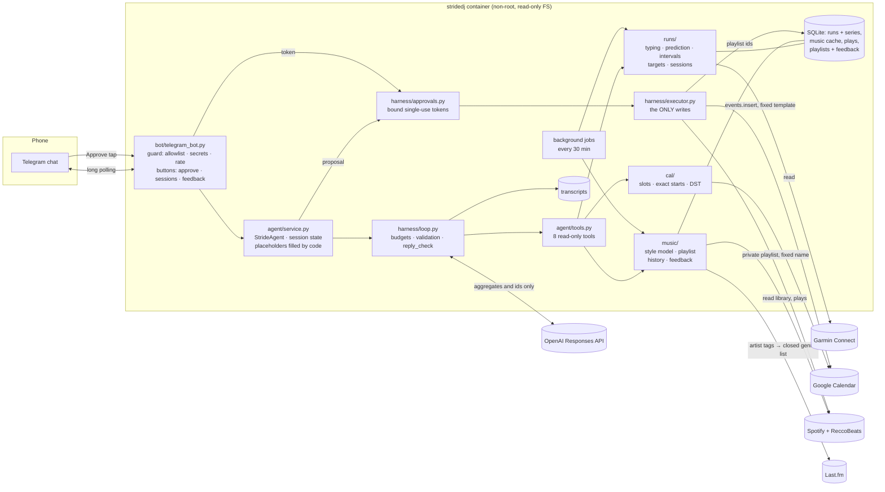

# Architecture

The overview above is for everyone. The technical structure, as a Mermaid graph (renders on GitHub):

## The request path
1. **Telegram → bot.** The guard runs in code: private chat only, allowlisted user ID, secret detector, length and rate limits. Button presses carry only ids (an approval token, an interval session id, a playlist id and a song position); they are parsed strictly and checked against the allowlist.
2. **StrideAgent** builds the context (versioned system prompt + current date/time + a 15-day date table + a compact history) and binds the eight tools to this user's session.
3. **The agent loop** calls OpenAI (strict tools + strict `AgentReply` output) and runs the requested tools in parallel, until a final answer or a budget stop. Every step goes into a transcript.
4. **The tools** call the domain services through ports:
   - `RunInsights`: duration p50/p80, cadence target, profile, race predictions, interval session options;
   - `SlotFinder`: example free slots, or an exact start check with the nearest free starts;
   - `PlaylistPlanner`: a draft playlist matched to cadence, style, music choice and genre.

   The model gets aggregates and ids, never raw data or untrusted text.
5. **A proposal** = a `RunPlan` built by code from session state (slot, duration, cadence, playlist draft, interval session). The harness attaches the plan created in this turn; the model never copies an id. The reply's placeholders (`{start}`, `{expected}`, `{session}`, `{music}` …) are filled from the plan, and every other number in the message must be a fact of the plan or something the runner wrote; otherwise code shows a standard message instead and records that in the transcript. Then an **approval token** is issued (bound to the plan hash and the user, single use, 15 min).
6. **Approve tap → executor.** It creates the private playlist and the calendar event (idempotent id, fixed templates, the interval session in the description) and records the playlist's track ids for rotation and feedback. These are the only writes in the system.

## Interval runs, end to end
1. **History.** Each run's per-second series (elapsed and timer time, distance, speed, heart rate, cadence; Garmin's position fields are never read) is stored locally. `runs/intervals.py` finds reps from pace, rests from watch stops (elapsed time grows while the timer doesn't; there are no samples during a stop) or slow stretches, and confirms them with the heart-rate drop over each rest.
2. **Targets.** `runs/targets.py` derives a target pace per rep distance from the runner's sessions and adapts it after each new one (clean / missed / faded, a 6-week rule). Targets are recomputed, never stored.
3. **Options.** `suggest_interval_sessions` builds short reps, medium reps and a pyramid (distance reps, standing rests), each with its own duration from the structure. The bot shows them as buttons; a tap becomes a code-made message, and the plan carries the chosen session.

## Background jobs (every 30 minutes while the bot runs)
| Job | Why |
|---|---|
| Spotify recently-played → plays log | Spotify keeps only the last 50 plays; the music played during runs is the strongest style signal |
| Artist genres → cache (Last.fm, throttled) | a draft rarely has to wait for genre lookups |
| New runs + their per-second series | a finished run is known within half an hour, interval detection included |

Each round is best effort: a failure is logged and the next round tries again.

## Trust boundaries
| Boundary | What crosses | What never crosses |
|---|---|---|
| Telegram ↔ bot | your messages; buttons with random tokens and ids | messages from non-allowlisted users; group chats |
| bot/agent ↔ OpenAI | your message, tool results (aggregates, ids, genre values from a closed list), previous final answers | GPS, raw series, activity names, track titles, calendar titles, crowd-written tags, secrets |
| agent ↔ Google | free/busy queries; one event insert after approval | event titles (never read), attendees (no such parameter) |
| agent ↔ Spotify | library and recently-played reads; one private playlist after approval | edits to your existing playlists |
| agent ↔ Garmin | activity summaries and per-second series (allowlisted fields only) | position (never read), activity names |
| agent ↔ Last.fm | artist names, to look up their tags | anything about you; the tags come back only as values from a closed genre list |

## Local state (SQLite in a volume, never in the model's context)
| Store | Contents |
|---|---|
| `stridedj.db` | activity summaries and per-second series (allowlisted columns; no GPS) |
| `music_cache.db` | audio features, track metadata, artist genres, the Spotify rate-limit block |
| `music_plays.db` | (track id, played at) pairs |
| `music_history.db` | created playlists (track ids), playlist ratings, disliked songs |
| `costs.db`, `traces/` | the cost ledger and run transcripts |

## Module map
| Package | Responsibility | Key idea |
|---|---|---|
| `domain/` | pydantic contracts | `extra="forbid"` + frozen: the allowlist is the model |
| `ports.py` | Protocols for every external dependency | fakes for tests, evals and demo; swap adapters freely |
| `llm/` | the OpenAI adapter, strict schemas, fakes | provider-neutral loop; stateless calls |
| `harness/` | loop, tools, context, guard, approvals, executor, tracing | the reusable agent machinery |
| `agent/` | prompts, tools, session, placeholders, orchestrator | the StrideDJ-specific part |
| `runs/` | Garmin / intervals.icu / demo sources, SQLite, typing, prediction, interval detection, targets, sessions | the DS core |
| `music/` | Spotify (PKCE), ReccoBeats, Last.fm, genres, style model, playlist assembly, history | tempo folding; titles and tags never leave |
| `cal/` | Google free/busy + insert, slot finding, exact-start checks | DST-safe, fail closed |
| `bot/`, `cli.py` | front-ends, buttons, background jobs | the same agent behind every transport |
| `app.py` | the composition root | demo vs live wiring in one place |
| `evals/` | tasks, graders, oracle, runner, viewer | grade outcomes, not paths |
