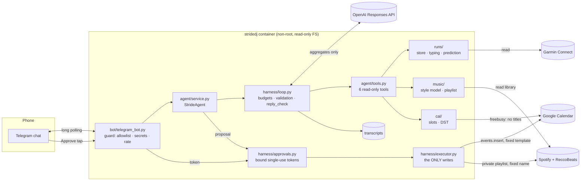

# Architecture

The same structure as a Mermaid graph (renders on GitHub):

## The request path
1. **Telegram → bot.** The guard runs in code: private chat only, allowlisted user ID, secret detector, length and rate limits.
2. **StrideAgent** builds the context (versioned system prompt + current date/time + a compact history) and binds the six tools to this user's session.
3. **The agent loop** calls OpenAI (strict tools + strict `AgentReply` output) and runs the requested tools in parallel, until a final answer or a budget stop. Every step goes into a transcript.
4. **The tools** call the domain services through ports:
   - `RunInsights`: duration p50/p80, cadence target, profile, race predictions;
   - `SlotFinder`: free slots via free/busy;
   - `PlaylistPlanner`: a draft playlist matched to cadence and style.
   
   The model gets aggregates and ids, never raw data or untrusted text.
5. **A proposal** = a `RunPlan` built by code from session state. The reply is checked against state (the proposal id must be real), then an **approval token** is issued (bound to the plan hash and the user, single use, 15 min).
6. **Approve tap → executor.** It creates the private playlist and the calendar event (idempotent id, fixed templates). These are the only writes in the system.

## Trust boundaries
| Boundary | What crosses | What never crosses |
|---|---|---|
| Telegram ↔ bot | your messages; buttons with a random token | messages from non-allowlisted users; group chats |
| bot/agent ↔ OpenAI | your message, tool results (aggregates, ids, sanitised genre tags), previous final answers | GPS, raw series, activity names, track titles, calendar titles, secrets |
| agent ↔ Google | free/busy queries; one event insert after approval | event titles (never read), attendees (no such parameter) |
| agent ↔ Spotify | library reads; one private playlist after approval | edits to your existing playlists |
| agent ↔ Garmin | activity summaries (allowlisted fields only) | — |

## Module map
| Package | Responsibility | Key idea |
|---|---|---|
| `domain/` | pydantic contracts | `extra="forbid"` + frozen: the allowlist is the model |
| `ports.py` | Protocols for every external dependency | fakes for tests, evals and demo; swap adapters freely |
| `llm/` | the OpenAI adapter, strict schemas, fakes | provider-neutral loop; stateless calls |
| `harness/` | loop, tools, context, guard, approvals, executor, tracing | the reusable agent machinery |
| `agent/` | prompt, tools, session, orchestrator | the StrideDJ-specific part |
| `runs/` | Garmin / intervals.icu / demo sources, SQLite, typing, prediction | the DS core |
| `music/` | Spotify (PKCE), ReccoBeats, style model, playlist assembly | tempo folding, titles never leave |
| `cal/` | Google free/busy + insert, slot finding | DST-safe, fail closed |
| `bot/`, `cli.py` | front-ends | the same agent behind every transport |
| `app.py` | the composition root | demo vs live wiring in one place |
| `evals/` | tasks, graders, oracle, runner, viewer | grade outcomes, not paths |
